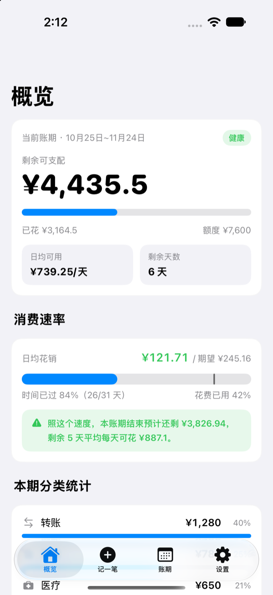
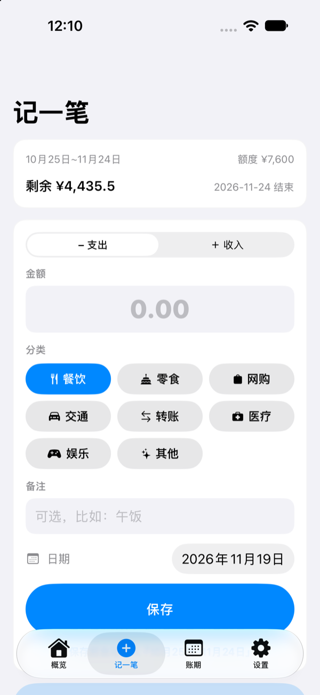
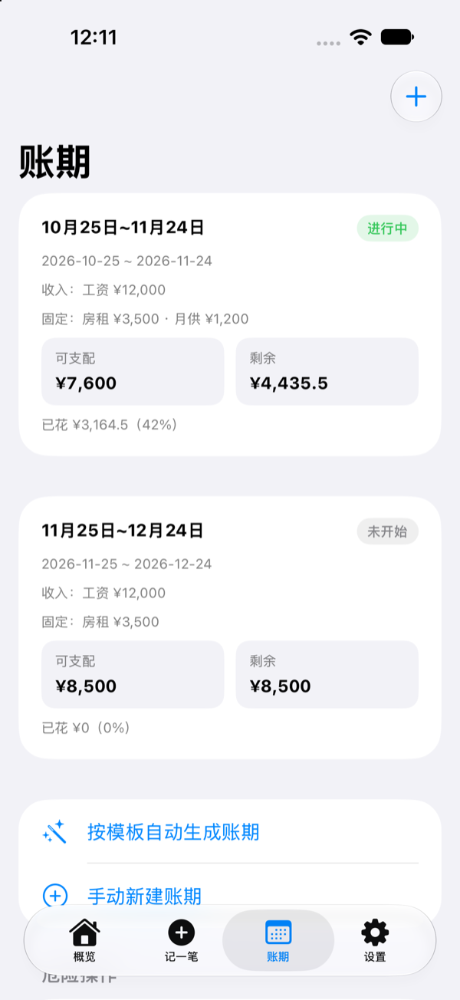
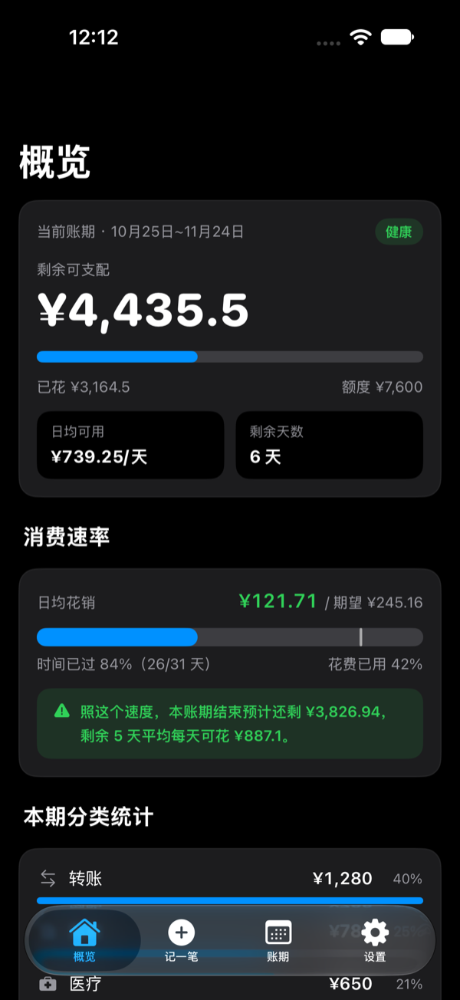
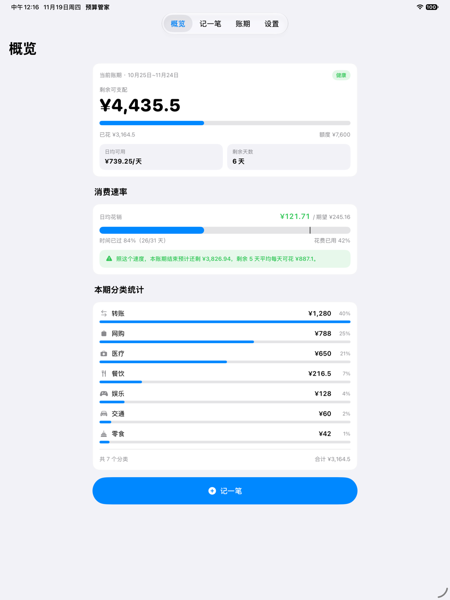
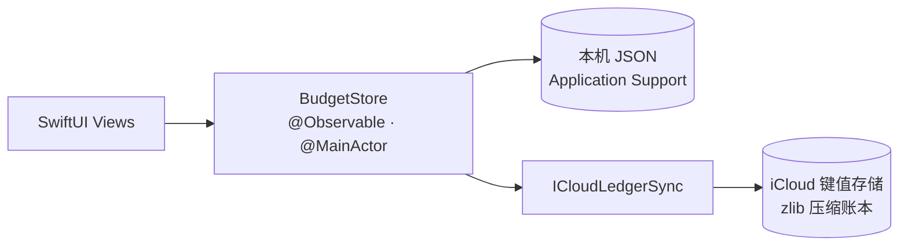

<p align="center">
  
</p>

<h1 align="center">预算管家</h1>

<p align="center">
  用 SwiftUI 写的「账期制」预算管理 App，iPhone · iPad · Mac 通用
</p>

<p align="center">
  
  
  
  <a href="LICENSE"></a>
</p>

---

预算管家把「发薪日」当作账期的起点：先扣掉房租、月供这类固定支出，算出这个周期**真正能花的钱**；再根据已经发生的消费速度，预测账期结束时还能剩多少。目标只有一个——在花钱之前，就知道还能花多少。

> 它最初是一个 H5 小工具，本仓库是用 SwiftUI 完整重写的原生版本；数据格式与旧版 H5 导出的 JSON 兼容。

## 预览

| 概览 | 记一笔 | 账期 |
| :---: | :---: | :---: |
|  |  |  |

| 深色模式 | iPad 自适应 |
| :---: | :---: |
|  |  |

## 功能

- **账期制预算**：以发薪日为锚点划分账期，自动汇总收入与固定支出，得到本期可支配额度。
- **消费速率预测**：按日均花费外推期末余额；花得太快会给出预警，超支则直接标红。
- **固定收支模板**：工资、房租、月供填一次，之后可一键生成后续账期，或在编辑账期时自动带入。
- **10 秒记一笔**：支出 / 收入、分类、备注、日期，键盘一收就能保存。
- **分类统计**：本期钱花在了哪里，按金额排序一目了然。
- **iCloud 同步与备份**：同一 Apple 账户下的 iPhone、iPad、Mac 自动同步；本机优先，冲突时以更新时间较新的版本为准。
- **JSON 导入 / 导出**：随时备份、迁移，也能直接导入旧版 H5 的数据。
- **原生多端体验**：动态字体、深色模式、iPad 与 Mac 的自适应布局，Mac 上还支持菜单与快捷键。

## 技术栈

- **SwiftUI**：全部界面使用原生组件，无第三方依赖。
- **Observation**（`@Observable` / `@MainActor`）：单一数据源，视图自动刷新。
- **NSUbiquitousKeyValueStore**：整本账本经 zlib 压缩后存入 iCloud 键值存储，实现无服务器同步。
- **JSON 文件持久化**：修改先落本机 Application Support，再防抖上传 iCloud。



## 目录结构

```text
Budget-ios/                    # 仓库根目录
├── Budget-ios.xcodeproj
├── Budget-ios.entitlements
├── docs/                      # README 截图与图标
└── Budget-ios/                # App 源码
    ├── App/                   # App 入口与根导航
    ├── Models/                # Codable 数据模型（兼容 H5 JSON）
    ├── Store/                 # 业务状态、预算计算、iCloud 同步
    ├── Views/                 # 四个主页面与编辑表单
    ├── Support/               # 日期 / 金额工具、跨平台样式与通用组件
    └── Assets.xcassets        # App 图标与强调色
```

## 快速开始

**环境要求**：Xcode 27.2+，iOS 27.2+ / macOS 27.2+，无需安装任何依赖。

1. 克隆仓库，用 Xcode 打开 `Budget-ios.xcodeproj`。
2. 在 target 的 **Signing & Capabilities** 中选择你的 Team（免费 Apple ID 也可以）。
3. 选择 iPhone / iPad / My Mac，按 ⌘R 运行。

命令行构建（模拟器，无需签名）：

```bash
xcodebuild -project Budget-ios.xcodeproj -scheme Budget-ios \
  -destination 'generic/platform=iOS Simulator' build
```

## iCloud 同步

同步基于 `NSUbiquitousKeyValueStore`：账本以 zlib 压缩后的 JSON 存储，多台设备按 `updatedAt` 新者胜出合并。压缩后体积需小于约 0.9 MB；超出时会保留本机数据并提示，不影响记账。

仓库里的 `Budget-ios.entitlements` 默认留空，方便用**免费 Apple ID** 直接真机安装。此时 App 会自动降级为纯本机模式（设置页显示「iCloud 不可用」），其余功能不受影响。

如需启用 iCloud 同步：

1. 使用付费 Apple Developer Program 账户；
2. 在 Xcode 的 **Signing & Capabilities** 中添加 **iCloud → Key-value storage**；
3. 在 `Budget-ios.entitlements` 中加入：

   ```xml
   <key>com.apple.developer.ubiquity-kvstore-identifier</key>
   <string>$(TeamIdentifierPrefix)$(CFBundleIdentifier)</string>
   ```

4. 将 Bundle ID 换成你自己的并重新签名。

## 数据与隐私

- 没有账号系统、没有自建服务器、没有统计埋点。
- 数据默认只保存在本机 App 沙盒的 JSON 文件里。
- 开启 iCloud 后，数据只写入你自己的 iCloud 键值存储。
- 建议定期使用「导出数据」保留一份 JSON 备份。

## 参与贡献

欢迎 Issue 和 PR。提交前请确认 iOS 与 macOS 两个目标都能编译通过。

## 许可证

本项目基于 [Apache License 2.0](LICENSE) 开源。Copyright © 2026 Budget-ios contributors.
